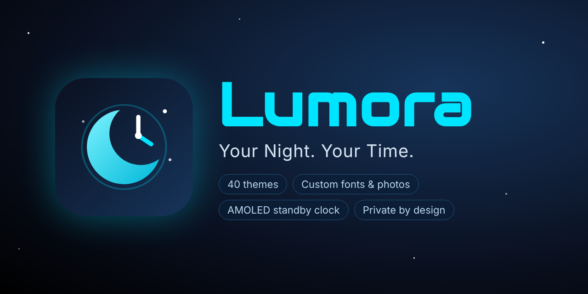

<p align="center">
  
</p>

<p align="center">
  <a href="https://github.com/Aasimabdul/lumora/actions/workflows/ci.yml"></a>
  <a href="https://github.com/Aasimabdul/lumora/actions/workflows/codeql.yml"></a>
  <a href="LICENSE"></a>
  
  
</p>

# Lumora — Your Night. Your Time.

Lumora is a free, open-source **standby clock for Android**. Put your phone on the charger and get a calm, AMOLED-friendly clock with 40 themes, your own fonts, colours and photo backgrounds, live date and battery, and optional privacy-first notification previews.

> **Status: feature-complete preview.** The app builds, and unit tests, lint and code scanning pass in CI. It has **not yet been run on a physical device or emulator**, so layouts and behaviour on real hardware are unverified. Early builds are published as pre-releases. Details: [docs/DEVELOPMENT_STATUS.md](docs/DEVELOPMENT_STATUS.md).

> **Not a lock screen.** Lumora is an app-level standby clock. It does not replace your lock screen or your phone's Always-On Display.

## Features

| | |
| --- | --- |
| **40 themes** | Digital, analog, futuristic, nature and creative designs, each with its own renderer. |
| **Make it yours** | Clock size, date/battery text size, position, 16 fonts (5 system + 11 bundled), weight, any `#RRGGBB` text colour, show/hide date and battery — with a live preview. |
| **My themes** | Save a look as a named theme with a colour or photo background (zoom, pan, darken, blur on Android 12+). Favourites, search and category filters. |
| **Standby mode** | Large clock with live time, date and battery on black. 12/24-hour time and several date formats. |
| **Charging automation** | Optional (off by default): opens standby when you plug in, while Lumora is open on screen. Android doesn't allow apps to launch themselves from the background. |
| **Notification previews** | Optional (off by default, separate build): a temporary card for notifications, 10–30 s auto-hide, privacy mode, per-app allow-list, memory only. |
| **Private by design** | No internet permission, no analytics, no ads. Photos stay in private app storage with location metadata removed. |

### The 40 themes

- **Digital** — Minimal Digital · Neon Cyan · Flip Clock · Split Clock · Vertical Clock · Retro Digital · Dot Matrix · Large Typography · Gradient Digits · Glitch Clock
- **Analog** — Analog Classic · Minimal Analog · Circle Glow · Roman Numerals · Analog + Calendar · Split Analog Dashboard · Modern Watch · Retro Clock Radio
- **Futuristic** — Cyberpunk · Aurora Glow · Wave Flow · Geometric Clock · Particle Glow · Speed Lines · Matrix Clock · HUD Dashboard
- **Nature** — Moon Phase · Starry Night · Mountain Night · Forest · Sunset · Space Explorer · Ocean Waves · Aurora Sky
- **Creative** — Colorful iOS-inspired Clock · Anime-inspired Clock · Dragon · Wolf · Custom Photo Clock · My Custom Layout

All artwork is original and drawn in code; no third-party characters or brand assets are used.

## Install

Pick the right APK from the [Releases](https://github.com/Aasimabdul/lumora/releases) page:

| APK | What you get |
| --- | --- |
| `Lumora-vX.Y.Z.apk` (**standard**) | Everything except notification previews. Does not declare a notification listener, so Google Play Protect does not block it for that reason. |
| `Lumora-vX.Y.Z-notifications.apk` | Adds optional notification previews. Install with `adb` (Play Protect blocks browser-installed apps that declare a notification listener). |

Step by step, including checksums, Play Protect and Android's "restricted settings": **[docs/INSTALL.md](docs/INSTALL.md)**. Releases marked `-debug` are signed with the Android debug key and are previews only.

## Privacy and permissions

- Lumora declares **no `<uses-permission>` entries**. Background photos use the system photo picker.
- Notification previews (notifications build only) need Android's special *Notification access*, which you grant yourself. Message text is kept **in memory only**, is never written to disk, logs or the network, and disappears on its own.
- Read more: [PRIVACY_POLICY.md](PRIVACY_POLICY.md) · [docs/PERMISSIONS.md](docs/PERMISSIONS.md) · [docs/THREAT_MODEL.md](docs/THREAT_MODEL.md)

## Build from source

Requirements: JDK 17, Android SDK 35 (for Gradle), Rust stable (optional, for `rust-core/`).

```bash
./gradlew :core:test :app:testStandardDebugUnitTest :app:testNotificationsDebugUnitTest
./gradlew :app:assembleStandardDebug
```

Full instructions: [docs/BUILDING.md](docs/BUILDING.md).

## Project layout

| Path | What it is |
| --- | --- |
| `app/` | Android app: Kotlin, Jetpack Compose, Material 3, Preferences DataStore. Two flavors: `standard` and `notifications`. |
| `core/` | Android-free Kotlin: theme catalog, validated settings, custom-theme model and JSON codec, moon phase, notification-preview state machine. Unit-tested. |
| `rust-core/` | Standalone Rust library (WCAG contrast maths, theme-config validation) with tests. **Not linked into the app yet.** |
| `docs/` | Architecture, building, install, permissions, threat model, status, release notes. |

Architecture overview: [docs/ARCHITECTURE.md](docs/ARCHITECTURE.md).

## Roadmap

Not done yet: testing on real devices, Compose/instrumented UI tests, Rust integration through JNI, a vibration option, signed release builds (needs the maintainer's signing key).

## Contributing and security

Contributions are welcome — see [CONTRIBUTING.md](CONTRIBUTING.md) and the [Code of Conduct](CODE_OF_CONDUCT.md). Report vulnerabilities **privately**: [SECURITY.md](SECURITY.md).

## Credits and licence

MIT — see [LICENSE](LICENSE). Bundled fonts (Audiowide, Michroma, Bebas Neue, Righteous, Anton, Poiret One, Pacifico, Lobster, Share Tech Mono, VT323, Press Start 2P) are under the SIL Open Font License; see [THIRD_PARTY_NOTICES.md](THIRD_PARTY_NOTICES.md).
